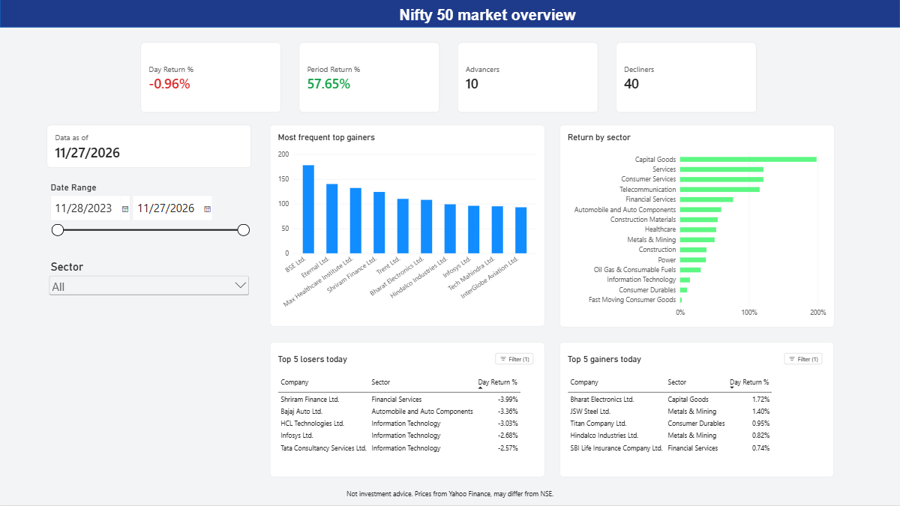
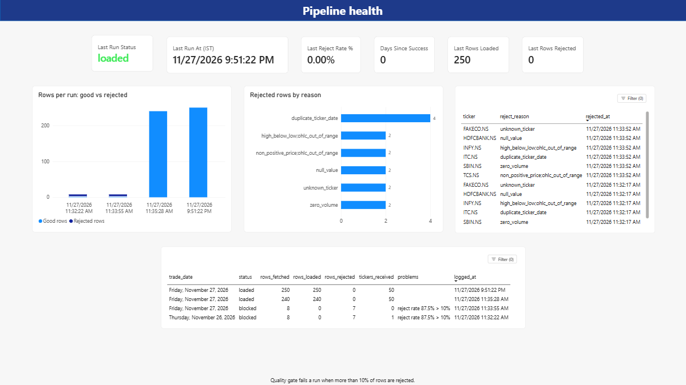
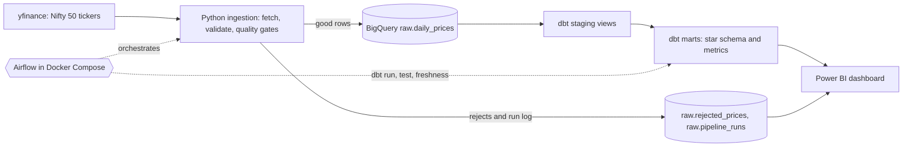

# Nifty Market Analytics Pipeline

[](https://github.com/VirajBarapatre/nifty-market-elt-pipeline/actions/workflows/ci.yml)

An automated ELT pipeline that loads daily OHLCV prices for Nifty 50 stocks into BigQuery, transforms them with dbt into tested analytics tables, orchestrates the runs with Airflow, and serves a Power BI dashboard.

> **Disclaimer:** This is a data engineering portfolio project. Nothing in this repository, its tables or its dashboard is investment advice or a recommendation to buy or sell any security. The data comes from an unofficial source and may be incomplete or wrong.

## Dashboard

Power BI report (`powerbi/nifty_dashboard.pbix`), Import mode on the dbt marts and the pipeline's audit tables.

**Market overview**: equal-weighted Nifty 50 return for the day, advancers vs decliners, period return by sector, today's top 5 gainers and losers, and which stocks led most often.



**Stock deep-dive**: adjusted close with 20 and 50-day moving averages, daily return, 30-day annualised volatility and volume for one stock.


**Pipeline health**: last run status, rows loaded vs rejected per run, rejected rows by reason, and the run log, read from `raw.pipeline_runs` and `raw.rejected_prices`.



Model: star schema with `dim_stock` and `dim_date` filtering `fact_daily_prices`, `mart_stock_metrics`, `mart_top_movers` and `mart_sector_daily` (single-direction, many-to-one). Measures live in a `_Measures` table.

## Architecture

The pipeline runs every weekday at 17:00 IST, after the NSE close:



Plain-text version:

```
yfinance (NSE tickers) -> Python ingestion -> BigQuery raw -> dbt staging -> dbt marts -> Power BI
                               ^ orchestrated daily by Airflow (Docker Compose) ^
```

## Tech stack

Python 3.11 · Airflow (Docker Compose) · Google BigQuery (free sandbox) · dbt-core + dbt-bigquery · pytest · GitHub Actions · Power BI Desktop

## Data layers

| Layer | BigQuery dataset | What it holds |
|---|---|---|
| Raw | `raw` | `daily_prices` (validated rows, as yfinance returned them), `daily_prices_incoming` (each run's batch), `rejected_prices` (quarantine), `pipeline_runs` (run log) |
| Seeds | `analytics_seeds` | Nifty 50 constituents with sectors (official NSE list), known corporate actions |
| Staging | `analytics_staging` | `stg_` views: renamed, typed, deduplicated |
| Marts | `analytics_marts` | `fact_daily_prices`, `dim_stock`, `dim_date`, `mart_stock_metrics`, `mart_top_movers`, `mart_sector_daily` |

## Setup

1. Install Python 3.11 and Docker Desktop.
2. Create a virtual env: `py -3.11 -m venv .venv`, then `.venv\Scripts\Activate.ps1`.
3. Install packages: `pip install -r requirements.txt`.
4. Create a BigQuery sandbox project and a service account with **BigQuery Data Editor** and **BigQuery Job User**. Save its JSON key **outside** this repo.
5. Copy `.env.example` to `.env` and fill in your values.
6. Check the connection: `python scripts/check_bq_connection.py`.
7. Start Airflow: in `airflow/`, run `docker compose --env-file ../.env up airflow-init`, then `docker compose --env-file ../.env up -d`. Open `http://localhost:8080` (local login airflow / airflow) and unpause `nifty_daily_pipeline`.
8. Open the dashboard: install Power BI Desktop (free, Windows), open `powerbi/nifty_dashboard.pbix`, then Home > Refresh. When asked, sign in to Google BigQuery with the Google account that owns your project, and change the project in Transform data > Data source settings if yours isn't `nifty-pipeline-viraj`. The file ships with a snapshot of the data, so it opens even without signing in.

## Design decisions

- **ELT, not ETL**: raw prices land in BigQuery untouched (plus validation), and all business logic lives in dbt SQL, so it is versioned, tested and re-runnable.
- **Idempotent loads without DML**: the BigQuery sandbox blocks MERGE/INSERT/UPDATE/DELETE, so each load writes the batch to `daily_prices_incoming` with a load job, then a query job rewrites `daily_prices` as old rows not in the batch plus the batch. Re-running any date replaces it instead of duplicating it.
- **7-day re-fetch on every run**: late, missing or intraday rows are corrected automatically by the next run, which is safe because the load is idempotent.
- **Keep both close and adj_close**: raw close matches NSE for reconciliation; adjusted close drives returns so dividends and splits don't look like crashes.
- **Ticker universe from the official NSE CSV, kept as a dbt seed**: one source of truth for ingestion and for the sector dimension.
- **Incremental fact without MERGE**: `fact_daily_prices` reads the previous table plus a 10-day lookback and rebuilds with CTAS, because dbt's BigQuery incremental strategies need MERGE.
- **Star schema**: `dim_stock` and `dim_date` (calendar days, with a trading-day flag) around a daily price fact, with metrics marts on top; the same shape is reused in Power BI with single-direction relationships.
- **Fail closed on bad batches**: a hard gate blocks the whole load if over 10% of rows are rejected or over 5% of price cells are null, and Airflow does not retry it (bad data stays bad). Missing tickers are a soft alert because the rows that did arrive are fine.
- **Quarantine and run log as append-only tables**: every rejected row and every run attempt is kept with a run_id, so failures can be investigated later and shown on the dashboard.
- **Known corporate actions as data**: demergers and vendor split errors are listed in a seed and their daily return is nulled, instead of silently editing prices.
- **Airflow derives the trade date from the run's logical date**, never from today's date, so backfills and re-runs give the same result; `max_active_runs=1` because the load rewrites a table.
- **dbt in its own virtualenv inside the Airflow image**, so dbt's and Airflow's dependency pins can't clash.
- **No credentials outside the laptop**: the service account key is bind-mounted read-only into the containers, never baked into the image, never in git, and CI runs without it.
- **Zero cost by design**: BigQuery sandbox, local Docker, Power BI Desktop and GitHub Actions free tier; table expiry is pushed forward on every run (with a margin under the sandbox's 60-day cap).

## Cost notes

Everything runs on free tiers: the BigQuery sandbox (no billing account; 10 GiB storage, 1 TiB of queries per month), Docker on a laptop, Power BI Desktop, and GitHub Actions. A full run reads a few MB, and the dashboard uses Import mode, so query volume stays far below the free limit.

## Data quality and monitoring

Every run is measured and gated before anything reaches `raw.daily_prices`:

| Check | Where | Effect |
|---|---|---|
| Row rules: nulls, prices <= 0, volume < 0 or = 0, high < low, open/close outside [low, high], duplicate ticker+date, unknown ticker | `ingestion/validate.py` | Row goes to quarantine `raw.rejected_prices` with a reason |
| Reject rate > 10%, null rate > 5%, or no rows | `ingestion/quality.py` (hard gate) | Load blocked, run fails, no retry |
| Any Nifty 50 ticker missing on the trade date | `ingestion/quality.py` (soft gate) | Rows loaded, run fails as an alert |
| Every stock present on the latest day | dbt test `assert_all_tickers_on_latest_day` | dbt_test fails |
| Raw data older than 3 / 5 days | `dbt source freshness` | Warn / fail |
| Daily move above 25% | dbt test `assert_daily_return_is_plausible` | Warning to investigate |

Every run, blocked or not, writes a row to `raw.pipeline_runs` (counts, rates, status, problems).

Demo: feed in a deliberately bad file and watch it get blocked:

```
python -m ingestion.run --input-file tests/fixtures/bad_prices.csv   # exit code 1, nothing loaded
```

In Airflow, copy the file to `airflow/data/` and trigger the DAG with config `{"input_file": "bad_prices.csv"}`.

## Testing and CI

Every push to main and every pull request runs three checks in GitHub Actions (`.github/workflows/ci.yml`). None of them touch BigQuery or need a secret.

| Job | What it checks |
|---|---|
| Python unit tests | `pytest` on Python 3.11: validation rules, quality gates, fetch (yfinance faked), ticker list, audit helpers. |
| dbt parse | Every model, source, seed and test resolves: broken refs, Jinja errors and bad YAML fail the build. |
| Airflow DAG integrity | The DAG imports under Airflow 3.4.0, has the expected 7 tasks, runs the quality gate before load and dbt, and allows one run at a time. |

Run the same tests locally with `pytest -q` (the DAG tests skip unless Airflow is installed). The pipeline itself is checked end to end by dbt tests and source freshness on every Airflow run.

Not covered by CI: SQL that only fails inside BigQuery (that needs a warehouse connection and credentials), and the yfinance API itself.

## Known limitations

- **yfinance is unofficial.** It scrapes Yahoo Finance, can be rate limited, and can return missing days, placeholder rows or bad tickers. The pipeline retries, validates and logs these, but the data is not guaranteed. In the 3-year backfill, 106 of 36,900 rows were rejected as zero-volume placeholder rows.
- **BigQuery sandbox limits.** No DML (MERGE, UPDATE, DELETE), so loads use a load job plus a query job that rewrites the table. Tables expire 60 days after creation; every run pushes the expiry forward (57 days, a margin under the cap), so a stopped pipeline loses its raw data after about two months and needs a backfill.
- **Survivorship bias.** The ticker list is today's Nifty 50, applied to all history. Stocks that left the index are missing, and some included stocks were not in the index for the whole period.
- **Intraday rows.** A run before the 15:30 IST close stores a mid-day price for today; the next run's 7-day lookback replaces it.
- **Corporate actions.** Yahoo doesn't adjust for demergers and sometimes mis-dates splits. Known cases live in `dbt/seeds/known_corporate_actions.csv`; their daily return is NULL, but nearby moving averages are still affected.
- **Alerts are log lines.** Failures write `ALERT ...` lines to the Airflow task logs and the CLI output, not Slack or email.

## What this does NOT prove

- **Not real-time or high-frequency**: one end-of-day bar per stock per day; no tick or intraday data.
- **Not trading-grade data**: prices come from Yahoo Finance via the unofficial yfinance library, not from NSE or a licensed vendor. Known vendor errors (a demerger, a mis-dated split adjustment) are documented, not fully corrected.
- **Not the official index**: returns are equal-weighted across today's 50 constituents, not the free-float weighted Nifty 50, and using today's list for 3 years adds survivorship bias.
- **Not cloud-scale**: about 37,000 rows. The full-table rewrite and single-machine Airflow are right for this size; at millions of rows you would use partitioned tables, MERGE on a billed project, and a managed or distributed scheduler.
- **Not production operations**: alerts are log lines, Airflow runs on one laptop that must be on, and the sandbox deletes tables if the pipeline stops for about two months.
- **Not investment advice**: nothing here is a recommendation to buy or sell anything.
