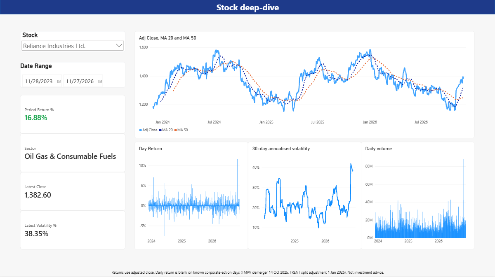

# Nifty Market Analytics Pipeline

An automated ELT pipeline that loads daily OHLCV prices for Nifty 50 stocks into BigQuery, transforms them with dbt into tested analytics tables, orchestrates the runs with Airflow, and serves a Power BI dashboard.

> **Disclaimer:** This is a data engineering portfolio project. Nothing in this repository, its tables or its dashboard is investment advice or a recommendation to buy or sell any security. The data comes from an unofficial source and may be incomplete or wrong.

## Dashboard

Power BI report (`powerbi/nifty_dashboard.pbix`), Import mode on the dbt marts and the pipeline's audit tables.

**Market overview**: equal-weighted Nifty 50 return for the day, advancers vs decliners, period return by sector, today's top 5 gainers and losers, and which stocks led most often.


**Stock deep-dive**: adjusted close with 20 and 50-day moving averages, daily return, 30-day annualised volatility and volume for one stock.



**Pipeline health**: last run status, rows loaded vs rejected per run, rejected rows by reason, and the run log, read from `raw.pipeline_runs` and `raw.rejected_prices`.


Model: star schema with `dim_stock` and `dim_date` filtering `fact_daily_prices`, `mart_stock_metrics`, `mart_top_movers` and `mart_sector_daily` (single-direction, many-to-one). Measures live in a `_Measures` table.

## Architecture

_Diagram coming in Milestone 8._

```
yfinance (NSE tickers) -> Python ingestion -> BigQuery raw -> dbt staging -> dbt marts -> Power BI
                               ^ orchestrated daily by Airflow (Docker Compose) ^
```

## Tech stack

Python 3.11 · Airflow (Docker Compose) · Google BigQuery (free sandbox) · dbt-core + dbt-bigquery · pytest · GitHub Actions · Power BI Desktop

## Data layers

| Layer | BigQuery dataset | What it holds |
|---|---|---|
| Raw | `raw` | Prices exactly as yfinance returned them |
| Staging | `analytics` (stg_ models) | Cleaned, renamed, typed, bad rows removed |
| Marts | `analytics` (fact/dim models) | Business-ready facts, dimensions and metrics for the dashboard |

## Setup

1. Install Python 3.11 and Docker Desktop.
2. Create a virtual env: `py -3.11 -m venv .venv`, then `.venv\Scripts\Activate.ps1`.
3. Install packages: `pip install -r requirements.txt`.
4. Create a BigQuery sandbox project and a service account with **BigQuery Data Editor** and **BigQuery Job User**. Save its JSON key **outside** this repo.
5. Copy `.env.example` to `.env` and fill in your values.
6. Check the connection: `python scripts/check_bq_connection.py`.
7. Start Airflow: in airflow/, run docker compose --env-file ../.env up airflow-init, then docker compose --env-file ../.env up -d. Open http://localhost:8080 (local login airflow / airflow) and unpause nifty_daily_pipeline.
8. Open the dashboard: install Power BI Desktop (free, Windows), open `powerbi/nifty_dashboard.pbix`, then Home > Refresh. When asked, sign in to Google BigQuery with the Google account that owns your project, and change the project in Transform data > Data source settings if yours isn't `nifty-pipeline-viraj`. The file ships with a snapshot of the data, so it opens even without signing in.

## Design decisions

_Filled in as each milestone lands._

## Cost notes

Runs entirely on the BigQuery sandbox (no billing account): 10 GiB storage, 1 TiB of queries per month.

## Data quality and monitoring

Every run is measured and gated before anything reaches `raw.daily_prices`:

| Check | Where | Effect |
|---|---|---|
| Row rules: nulls, prices <= 0, volume < 0 or = 0, high < low, open/close outside [low, high], duplicate ticker+date, unknown ticker | `ingestion/validate.py` | Row goes to quarantine `raw.rejected_prices` with a reason |
| Reject rate > 10%, null rate > 5%, or no rows | `ingestion/quality.py` (hard gate) | Load blocked, run fails, no retry |
| Any Nifty 50 ticker missing on the trade date | `ingestion/quality.py` (soft gate) | Rows loaded, run fails as an alert |
| Every stock present on the latest day | dbt test `assert_all_tickers_on_latest_day` | dbt_test fails |
| Raw data older than 3 / 5 days | `dbt source freshness` | Warn / fail |
| Daily move above 25% | dbt test `assert_daily_return_is_plausible` | Warning to investigate |

Every run, blocked or not, writes a row to `raw.pipeline_runs` (counts, rates, status, problems).

Demo: feed in a deliberately bad file and watch it get blocked:

```
python -m ingestion.run --input-file tests/fixtures/bad_prices.csv   # exit code 1, nothing loaded
```

In Airflow, copy the file to `airflow/data/` and trigger the DAG with config `{"input_file": "bad_prices.csv"}`.

## Known limitations

- **yfinance is unofficial.** It scrapes Yahoo Finance, can be rate limited, and can return missing days, placeholder rows or bad tickers. The pipeline retries, validates and logs these, but the data is not guaranteed. In the 3-year backfill, 106 of 36,900 rows were rejected as zero-volume placeholder rows.
- **BigQuery sandbox limits.** No DML (MERGE, UPDATE, DELETE), so loads use a load job plus a query job that rewrites the table. Tables expire 60 days after creation; the loader pushes the expiry forward on every run, so a stopped pipeline loses its raw data after about two months and needs a backfill.
- **Survivorship bias.** The ticker list is today's Nifty 50, applied to all history. Stocks that left the index are missing, and some included stocks were not in the index for the whole period.
- **Intraday rows.** A run before the 15:30 IST close stores a mid-day price for today; the next run's 7-day lookback replaces it.
- Corporate actions: Yahoo doesn't adjust for demergers and sometimes mis-dates splits. Known cases live in `dbt/seeds/known_corporate_actions.csv`; their daily return is NULL, but nearby moving averages are still affected.
- Alerts are log lines (`ALERT ...`) in Airflow task logs and the CLI output, not Slack or email.

## What this does NOT prove

_Filled in at Milestone 8: no tick data, not for trading, no cloud-scale load, unofficial data source._
